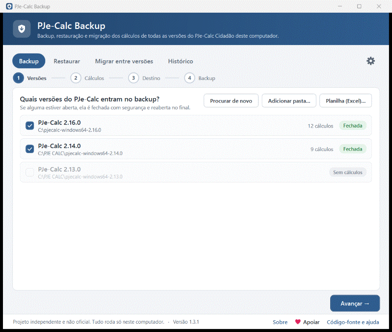
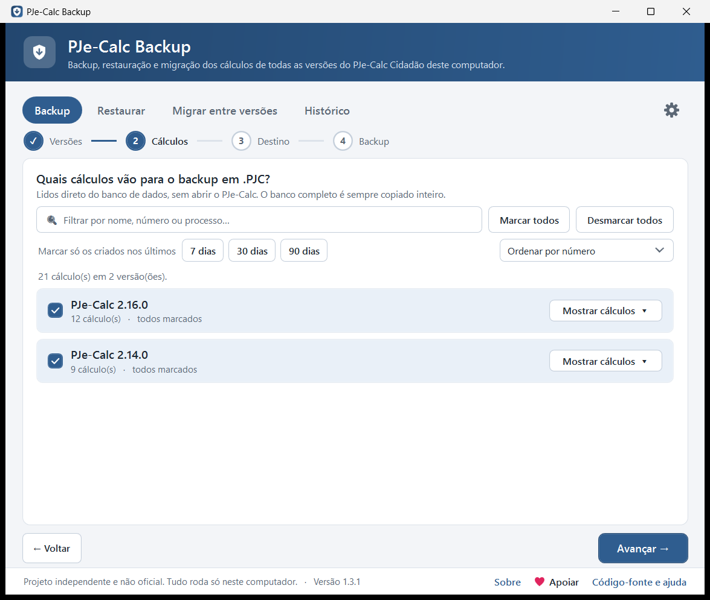
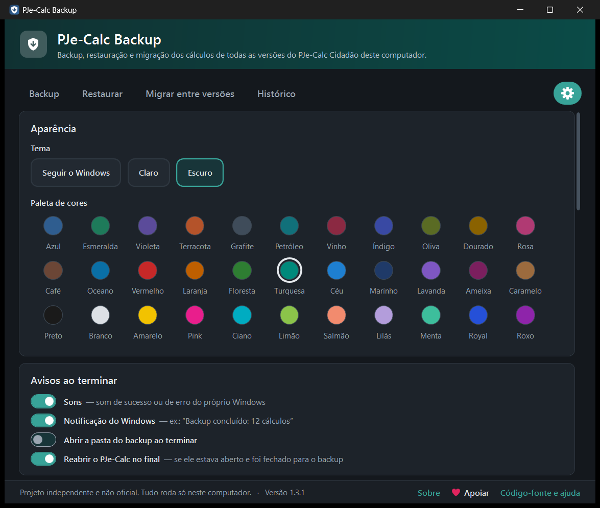
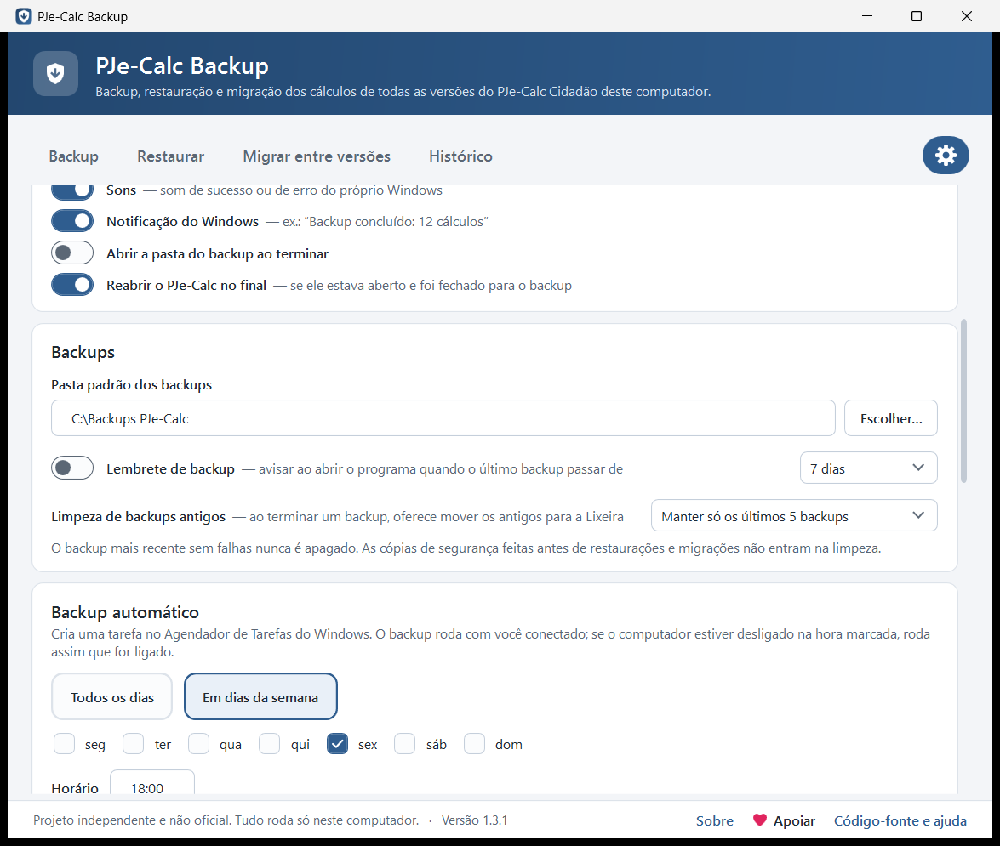

# PJe-Calc Backup

Programa para Windows que faz **backup, restauração e migração dos cálculos do PJe-Calc Cidadão**, em todas as versões instaladas no computador, com uma tela moderna em etapas.

<p align="center"></p>

- **Backup:** exporta os cálculos em `.PJC` (todos ou só os escolhidos) e copia o banco de dados completo de cada versão, com **conferência** ("12 de 12 conferidos").
- **Backup rápido:** só os cálculos novos ou alterados são exportados; os que não mudaram são copiados do backup anterior (o segundo backup leva segundos em vez de minutos).
- **Restauração:** importa arquivos `.PJC` **avisando os que parecem já existir**, ou restaura o banco completo de um backup.
- **Migração entre versões:** leva os cálculos de uma versão para outra (ex.: da 2.14 para a 2.16) num clique, sem duplicar os que já existem.
- **Backup automático** em dias e horário escolhidos (Agendador de Tarefas do Windows).
- **Busca** de um cálculo dentro de todos os backups, por nome ou nº do processo, com botão para restaurar só aquele.
- **Planilha (Excel)** com todos os cálculos das versões instaladas.
- **Limpeza de backups antigos** (vão para a Lixeira) e **atualização com um clique**, conferindo o SHA-256.
- **Histórico** dos backups, **lembrete** de backup, **temas** claro/escuro e 33 paletas de cores, **sons** e **notificações** do Windows.
- **Versão para o CMD**, com menus interativos e um modo automático.

> [!IMPORTANT]
> Projeto **independente e não oficial**. Não tem vínculo com nenhum TRT, com o CSJT ou com a equipe do PJe-Calc. Use por sua conta e risco.

Testado no PJe-Calc Cidadão **2.14.0** e **2.16.0**, no Windows 11.

---

## Download

**[⬇ Baixar a versão mais recente](../../releases/latest)**

| Arquivo | Para quê |
|---|---|
| `PJeCalcBackup.exe` | O programa com janela (já traz dentro a versão para o CMD). Basta baixar e dar dois cliques. |
| `PJeCalcBackup-vX.Y.Z.zip` | O pacote completo, com os arquivos separados: o programa com janela, a **versão para o CMD** (`PJeCalcBackup-Console.exe`) e o `backup-calculos.bat`. |

Funciona no Windows 10 e 11. Na primeira vez, o programa oferece **Instalar neste computador** (um clique, sem pedir senha de administrador): ele se copia para a pasta do usuário, cria atalhos na Área de Trabalho e no menu Iniciar e aparece em **Configurações do Windows → Aplicativos instalados**, de onde pode ser desinstalado. Também dá para usar sem instalar.

> Na primeira vez o Windows pode mostrar **"O Windows protegeu o computador"**, porque o programa não tem assinatura digital, que é paga. Clique em **Mais informações → Executar assim mesmo**. Os arquivos são compilados automaticamente pelo GitHub a partir deste código, e os SHA-256 aparecem na página de Releases.

---

## Sobre 🇧🇷

Este programa nasceu de uma dificuldade real no dia a dia da advocacia: ao instalar uma versão nova do PJe-Calc, os cálculos não vão junto, e a única saída era exportar e importar um por um, manualmente, o que levava horas. O PJe-Calc Backup faz isso de forma automática e segura, com conferência no final.

Projeto independente, gratuito e de código aberto, feito no Brasil.

## Por que existe

O PJe-Calc guarda os cálculos num banco de dados **dentro da pasta de cada versão** (`.dados\pjecalc.h2.db`). Quando se instala uma versão nova em outra pasta, os cálculos antigos **não vão junto**, e não há backup automático. Exportar e importar cálculo por cálculo pela tela é demorado.

## Como usar

Cada operação é feita **em etapas**, com **Voltar**, **Avançar** e **Concluir** (ou pelo teclado: **Enter** avança, **Esc** volta, **Ctrl+F** vai para o filtro). Antes de começar, um aviso pede para você **salvar e fechar o que estiver editando** no PJe-Calc.

| Escolha das versões | Cálculos agrupados por versão |
|---|---|
|  |  |
| **33 cores, tema claro ou escuro** | **Configurações com interruptores** |
|  |  |

### Backup
1. **Versões:** o programa encontra sozinho as versões instaladas e mostra o estado (*Fechada* / *Aberta agora*) e o número de cálculos de cada uma.
2. **Cálculos:** a lista é lida direto do banco, sem abrir o PJe-Calc. Cada versão aparece recolhida, com quantos cálculos estão marcados e o botão **Mostrar cálculos**. Mostra número, reclamante, reclamado, processo e datas. Tem filtro, ordenação (número, nome ou mais recentes), "Marcar só os criados nos últimos 7/30/90 dias" e "Marcar/Desmarcar todos". Os cálculos que você desmarcou vêm desmarcados de novo no próximo backup.
3. **Destino:** a pasta e o que incluir (`.PJC` e/ou o banco completo), e o **backup rápido** (ligado por padrão).
   O backup rápido compara cada cálculo com o backup anterior por uma "impressão digital" tirada do banco do PJe-Calc (o contador de versão que o PJe-Calc atualiza a cada gravação, no cálculo e nas verbas, histórico salarial, FGTS etc.). O que não mudou é copiado do backup anterior; só o que é novo ou foi alterado é exportado. Se não houver nada novo, o PJe-Calc nem é aberto. Cada pasta de backup continua completa, e o banco inteiro continua sendo copiado sempre.
4. **Backup:** barra de progresso, registro de cada cálculo e conferência no final.

Cada backup cria uma pasta nova com a data e a hora; nada é apagado:

```
BKP PJC PJECALC\
└── 2026-11-08_0130\
    ├── relatorio.txt   ·   backup.json (usado pelo histórico)
    ├── PJe-Calc 2.16.0\
    │   ├── banco-de-dados-pjecalc-2.16.0.zip
    │   └── CALCULO_1_FULANO DE TAL_DATA_..._HORA_....PJC  …
    └── PJe-Calc 2.14.0\  …
```

### Restaurar
- **Cálculos (.PJC):** escolha arquivos ou uma pasta de backup (os arquivos aparecem agrupados pela versão de onde vieram) e a versão de destino. O programa lê os `.PJC`, compara com os cálculos do destino e mostra **"Parece já existir (nº 35)"**. Esses vêm desmarcados, para não duplicar. Cada arquivo importado vira um cálculo novo, com número novo.
- **Banco completo (.zip):** volta a versão inteira para como estava no backup. Só é permitido na mesma versão do PJe-Calc do backup.

Nos dois casos, **antes de mexer em qualquer coisa** o programa guarda uma cópia do banco atual numa pasta `… (antes da restauração)`, para você poder desfazer.

### Migrar entre versões
Escolha a versão de origem e a de destino. Os cálculos que já existem no destino vêm desmarcados. O programa exporta da origem (que não é alterada), guarda uma cópia do banco de destino e importa os escolhidos.

### Histórico e busca
Lista os backups, restaurações e migrações feitos na pasta de backups, com data, versões, quantidade de cálculos e conferência. Cada item tem os botões **Abrir pasta**, **Restaurar .PJC** e **Restaurar banco**.

A caixa de busca procura um cálculo **dentro de todos os backups** (nome do reclamante ou reclamado, nº do processo) e mostra em quais backups ele está, com os botões **Mostrar arquivo** e **Restaurar** (restaura só aquele cálculo). O botão **Limpar antigos…** aplica a regra de limpeza.

### Planilha (Excel)
Na etapa 1 do Backup, o botão **Planilha (Excel)…** salva um `.xlsx` com todos os cálculos das versões marcadas: versão, número, reclamante, reclamado, processo e datas, com filtro e cabeçalho fixo. Não precisa do Excel para gerar. A planilha tem nomes das partes: guarde-a em local seguro.

### Configurações (⚙, à direita das abas)
- **Aparência:** tema **Claro**, **Escuro** ou **Seguir o Windows**, e 33 paletas de cores, inclusive Preto, Branco, Amarelo e Pink (nas cores claras o texto fica escuro, para continuar legível).
- **Avisos ao terminar:** som do próprio Windows (sucesso ou erro), notificação do Windows, abrir a pasta ao terminar e reabrir o PJe-Calc no final.
- **Backups:** a pasta padrão, o **lembrete** ("Seu último backup foi há 12 dias") e a **limpeza de backups antigos**: "manter só os últimos 5/10/20/30" ou "apagar os com mais de 3/6/12 meses". Ao terminar um backup, o programa mostra quais sairiam e pergunta antes. Eles vão para a **Lixeira**. O backup mais recente sem falhas nunca é apagado, e as cópias de segurança de restaurações e migrações não entram na limpeza.
- **Backup automático:** todos os dias ou em dias da semana, no horário escolhido. Cria a tarefa "PJe-Calc Backup automático" no Agendador de Tarefas do Windows. Roda com você conectado; se o computador estiver desligado na hora marcada, roda assim que ele for ligado. Se o PJe-Calc estiver aberto, uma janela avisa e espera 2 minutos antes de fechá-lo com segurança; dá para fazer na hora, adiar 30 minutos ou pular. No final aparece uma notificação. Se um backup automático **falhar** ou **deixar de rodar** (computador desligado por vários dias), o programa avisa ao abrir e também com uma notificação ao entrar no Windows.
- **Atualizações:** verifica no GitHub se há versão nova. Só consulta a página do projeto; nenhum dado seu é enviado. Com **Atualizar agora**, o programa baixa a versão nova, confere o SHA-256 de cada arquivo e se reinicia.

Durante uma operação, o ícone na **barra de tarefas** mostra o progresso.

## Versão para o CMD

Dê dois cliques em **`backup-calculos.bat`** (vem no pacote `.zip`). Ele abre o `PJeCalcBackup-Console.exe`, com menus navegados pelas setas, Enter, Espaço (para marcar) e Esc. Tem as mesmas funções: backup escolhendo versões, cálculos e pasta; restauração com aviso de duplicados; migração; restauração do banco; histórico; busca nos backups; planilha; limpeza; configurações (inclusive backup automático e atualização).

**Arrastar e soltar:** arraste arquivos `.PJC` (ou uma pasta de backup) sobre o `backup-calculos.bat` para restaurá-los. Arraste o `.zip` de um backup do banco para restaurar o banco.

**Modo automático**, sem perguntas:

```
PJeCalcBackup-Console.exe --backup [--destino "pasta"] [--versoes 2.16.0,2.14.0]
                          [--pasta "C:\pjecalc-..."] [--sem-pjc] [--sem-banco] [--nao-reabrir]
                          [--agendado] [--limpar] [--rapido | --completo]
PJeCalcBackup-Console.exe --atualizar
```

- `--agendado`: é o que o backup automático usa. Respeita as versões desmarcadas no programa, avisa se o PJe-Calc estiver aberto e mostra uma notificação no final.
- `--limpar`: depois do backup, aplica a limpeza de backups antigos sem perguntar.
- `--rapido` / `--completo`: força o backup rápido (só novos ou alterados) ou a exportação de todos. Sem nenhum dos dois, vale a opção das Configurações.
- `--atualizar`: baixa e instala a versão nova, conferindo o SHA-256.

O código de saída é 0 quando deu tudo certo e 1 quando houve falhas.

## Como funciona por dentro

1. **Se o PJe-Calc estiver aberto**, o programa o **fecha com segurança**. Ele envia ao Java do PJe-Calc o mesmo aviso que o Windows envia ao desligar o computador, e o PJe-Calc desliga e fecha o banco de forma ordenada, igual ao **Sair** do ícone na bandeja. O programa **nunca encerra à força**. No final, reabre o PJe-Calc.
2. **Lê os cálculos** a partir de uma cópia temporária do banco, com o H2 que já vem no PJe-Calc. Não abre o programa nem altera o banco.
3. **Liga o PJe-Calc em segundo plano**, sem janela e sem abrir o Firefox, e exporta ou importa fazendo o mesmo caminho da tela (**Buscar → Abrir → Exportar**, **Importar → Confirmar**), com o Edge ou o Chrome em modo invisível.
4. **Desliga o PJe-Calc pelo comando oficial do Tomcat**, que fecha o banco corretamente.

> Enquanto o programa trabalha, **não abra o PJe-Calc pelo atalho**.

## Requisitos

- Windows 10 ou 11 (usa o .NET Framework 4.8, que já vem no Windows).
- Microsoft Edge ou Google Chrome, para exportar e importar `.PJC`.

## Privacidade

- Tudo roda **somente no seu computador** (`127.0.0.1`). A internet só é usada para verificar se há versão nova no GitHub (pode ser desligada) e, quando você clica em **Atualizar agora**, para baixá-la.
- Os arquivos `.PJC` e o banco contêm dados pessoais das partes (nomes, CPF etc.). Guarde os backups em local seguro e **nunca** os coloque em repositórios públicos. O [`.gitignore`](.gitignore) deste projeto já bloqueia esses arquivos.

## Limitações conhecidas

- O programa depende da estrutura das telas do PJe-Calc. Uma versão futura pode mudar algo e exigir ajuste. Confira sempre o relatório.
- A detecção de duplicados compara reclamante, reclamado, processo e as datas do contrato e do cálculo. Dois cálculos idênticos nesses dados são tratados como o mesmo.
- Uma versão que nunca foi aberta pelo atalho oficial precisa ser aberta uma vez antes do primeiro uso.

## Código-fonte

| Pasta | O que é |
|---|---|
| [`app/`](app/) | O código do programa (C#/WPF). `app\compilar.ps1` gera os dois executáveis usando o compilador que já vem no Windows. |
| [`backup-calculos/`](backup-calculos/) | O `.bat` que abre a versão para o CMD. |

```powershell
powershell -ExecutionPolicy Bypass -File app\compilar.ps1
```

## Contribuindo

Encontrou um problema ou testou em outra versão? Abra uma *issue* dizendo a versão do PJe-Calc e do Windows e colando o `relatorio.txt`, **sem dados de clientes**.

## ❤️ Apoie este projeto

O PJe-Calc Backup é gratuito e continuará sendo. Se ele economizou o seu tempo, você pode apoiar o desenvolvimento com um PIX de qualquer valor. Obrigado!

**Chave PIX (aleatória):** `7828ccd8-a4ad-4757-8acf-6d968c74c3a8`


No app do banco: **Pix → Pagar com chave** (cole a chave) ou leia o QR Code. O nome do recebedor aparece antes de você confirmar. A chave e o QR Code também ficam no programa, em ⚙ → **Apoie este projeto**.

## Licença

[MIT](LICENSE): software livre. Pode usar, copiar, modificar e compartilhar, mantendo o aviso de autoria. É fornecido sem garantia.
