<h1 align="center">PJe-Calc Backup</h1>

<p align="center">
Backup, restauração e migração dos cálculos do <b>PJe-Calc Cidadão</b>, em todas as versões instaladas no computador, com a numeração dos cálculos sempre em ordem.<br>
Gratuito, de código aberto e feito no Brasil 🇧🇷
</p>

<p align="center">
<a href="../../releases/latest"></a>
<a href="../../releases"></a>

<a href="LICENSE"></a>
</p>

<p align="center">
<a href="../../releases/latest"><b>⬇ Baixar</b></a>
&nbsp;&nbsp;·&nbsp;&nbsp;
<a href="../../wiki"><b>📖 Guia passo a passo (Wiki)</b></a>
&nbsp;&nbsp;·&nbsp;&nbsp;
<a href="#️-apoie-este-projeto"><b>❤️ Apoiar</b></a>
</p>

<p align="center"></p>

> [!IMPORTANT]
> Projeto **independente e não oficial**. Não tem vínculo com nenhum TRT, com o CSJT ou com a equipe do PJe-Calc. Tudo roda só no seu computador.

## Por que existe

O PJe-Calc guarda os cálculos num banco de dados **dentro da pasta de cada versão**. Quando se instala uma versão nova em outra pasta, os cálculos antigos **não vão junto**, e o PJe-Calc não tem backup automático. A única saída era exportar e importar cálculo por cálculo pela tela, o que levava horas.

O PJe-Calc Backup faz isso sozinho, com segurança, e confere o resultado no final. Ele também resolve um incômodo do dia a dia: a numeração dos cálculos que pula, por exemplo do 2 para o 33.

## O que ele faz

<table>
<tr>
<td width="50%" valign="top">
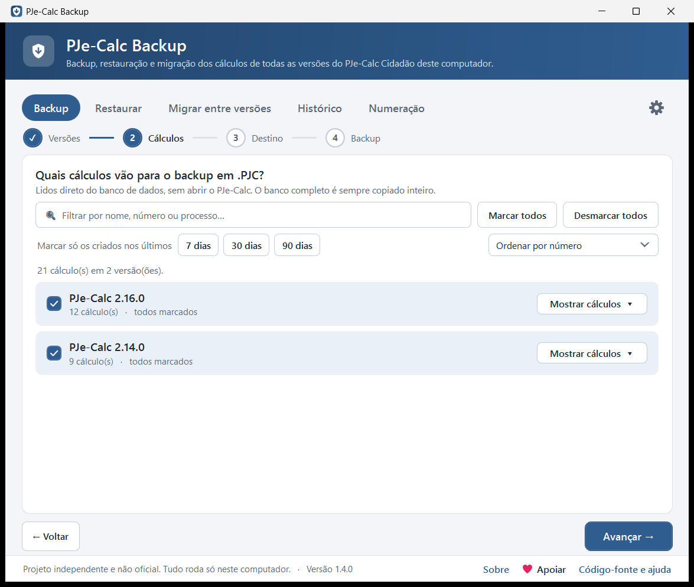<br>
<b>Backup de todas as versões</b><br>
Exporta cada cálculo em <code>.PJC</code> e copia o banco inteiro de cada versão. A lista é lida direto do banco, sem abrir o PJe-Calc, com filtro e "marcar os criados nos últimos 7, 30 ou 90 dias".
</td>
<td width="50%" valign="top">
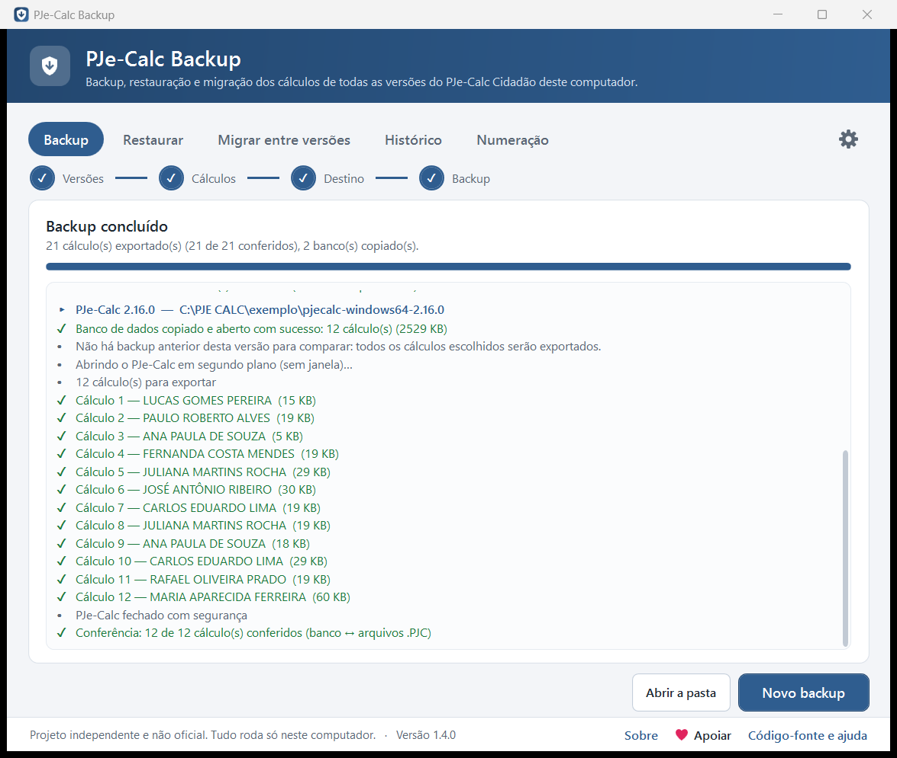<br>
<b>Conferência no final</b><br>
Cada <code>.PJC</code> gerado é aberto e comparado com o banco: "21 de 21 conferidos". A cópia do banco também é aberta, para provar que está íntegra.
</td>
</tr>
<tr>
<td valign="top">
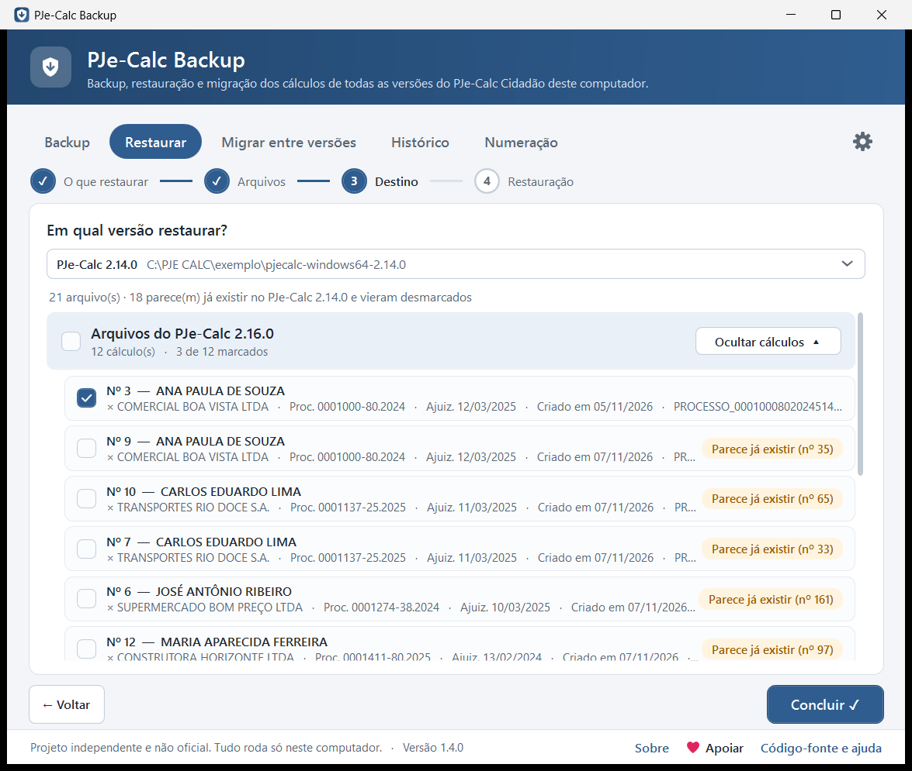<br>
<b>Restauração sem duplicar</b><br>
Restaura cálculos <code>.PJC</code> em qualquer versão e deixa desmarcados os que <b>parecem já existir</b>. Ou volta o banco inteiro para o dia do backup. Antes, sempre guarda uma cópia do banco atual, para dar para desfazer.
</td>
<td valign="top">
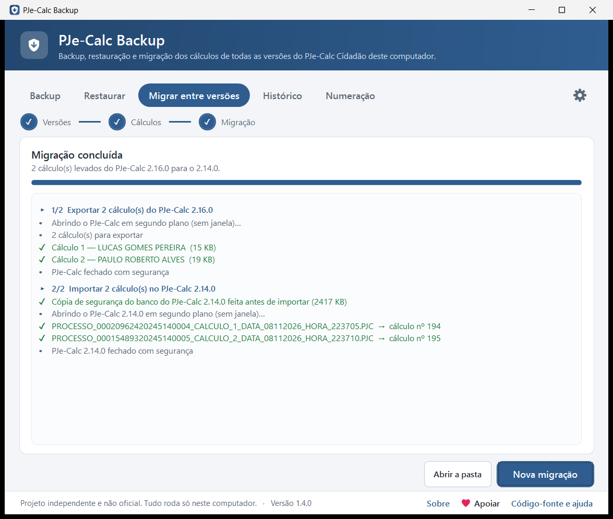<br>
<b>Migração entre versões</b><br>
Leva os cálculos de uma versão do PJe-Calc para outra sem mexer na origem e sem duplicar o que já foi levado.
</td>
</tr>
<tr>
<td valign="top">
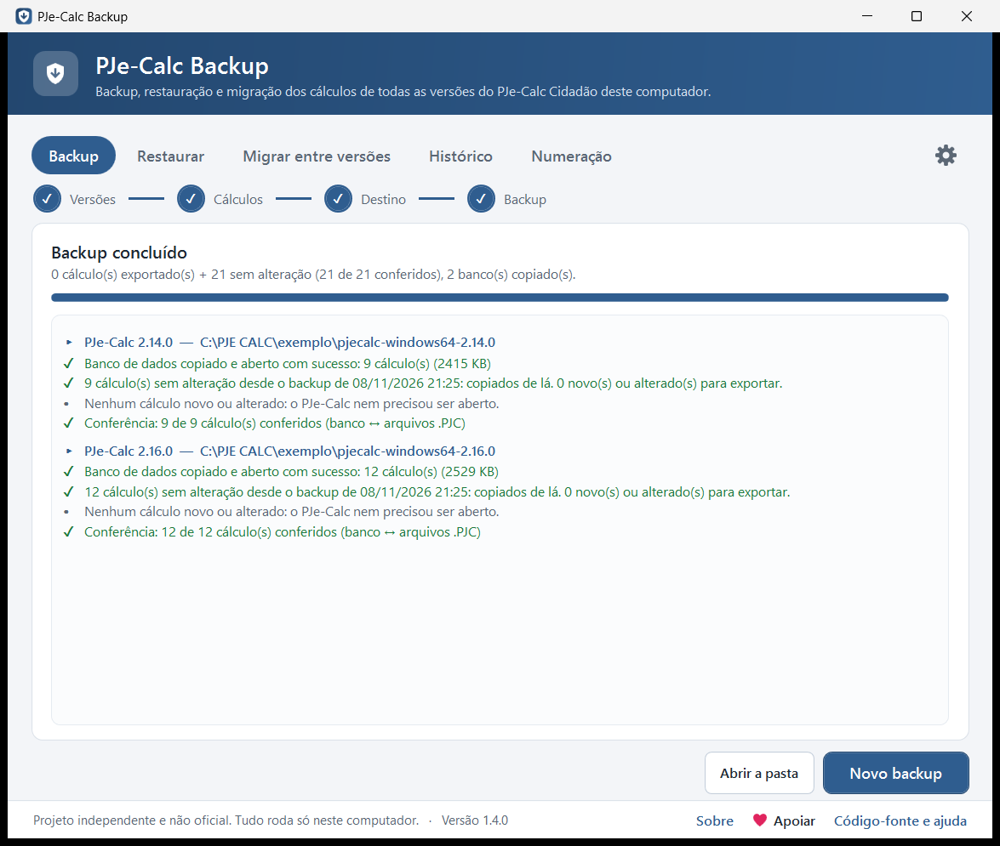<br>
<b>Backup rápido</b><br>
Só os cálculos novos ou alterados são exportados; os outros são copiados do backup anterior. Se nada mudou, o PJe-Calc nem é aberto e o backup termina em segundos.
</td>
<td valign="top">
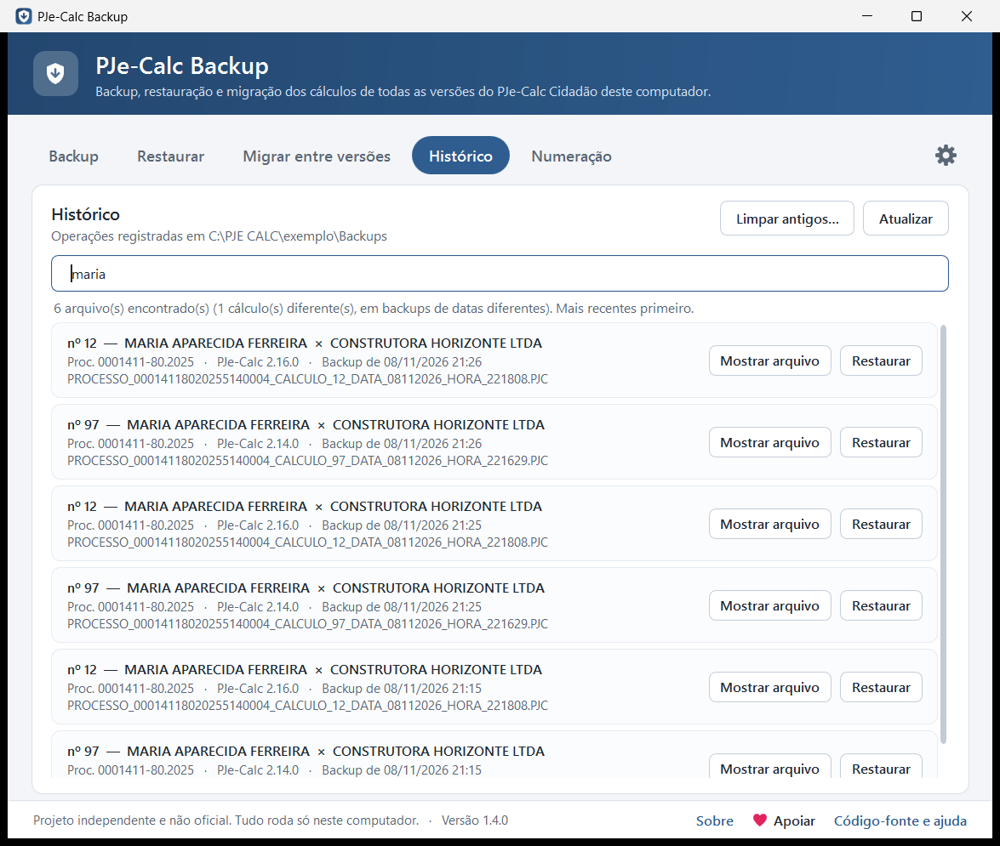<br>
<b>Histórico e busca</b><br>
Todos os backups, restaurações, migrações e mudanças de numeração numa lista. A busca acha um cálculo dentro de todos os backups pelo nome ou pelo processo, e restaura só ele.
</td>
</tr>
<tr>
<td valign="top">
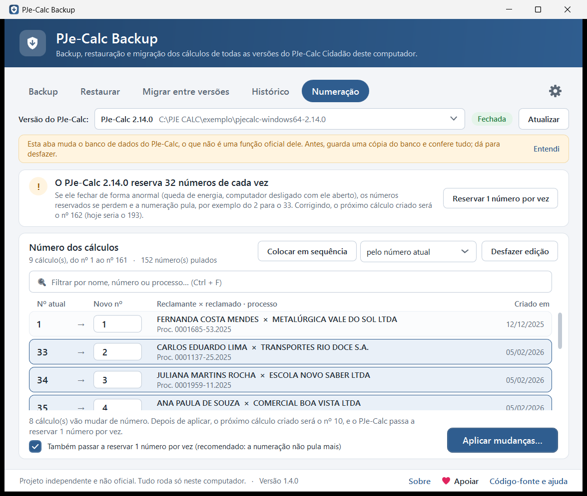<br>
<b>Numeração em ordem</b><br>
Faz o PJe-Calc reservar 1 número por vez, para a numeração não pular mais, e coloca os cálculos em sequência (1, 2, 3…). Tudo numa cópia conferida do banco, com opção de desfazer. <a href="#numeração-dos-cálculos">Saiba mais</a>.
</td>
<td valign="top">
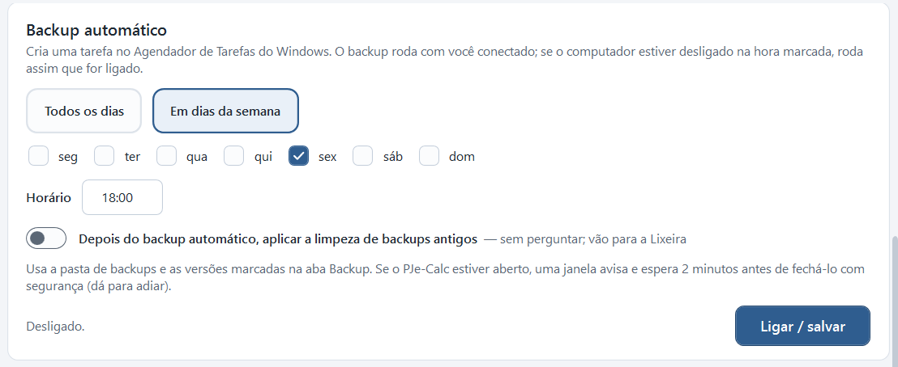<br>
<b>Backup automático</b><br>
Todos os dias ou nos dias escolhidos, pelo Agendador de Tarefas do Windows. Se o computador estava desligado na hora, roda quando ligar. Avisa se um backup falhar ou deixar de rodar.
</td>
</tr>
<tr>
<td valign="top">
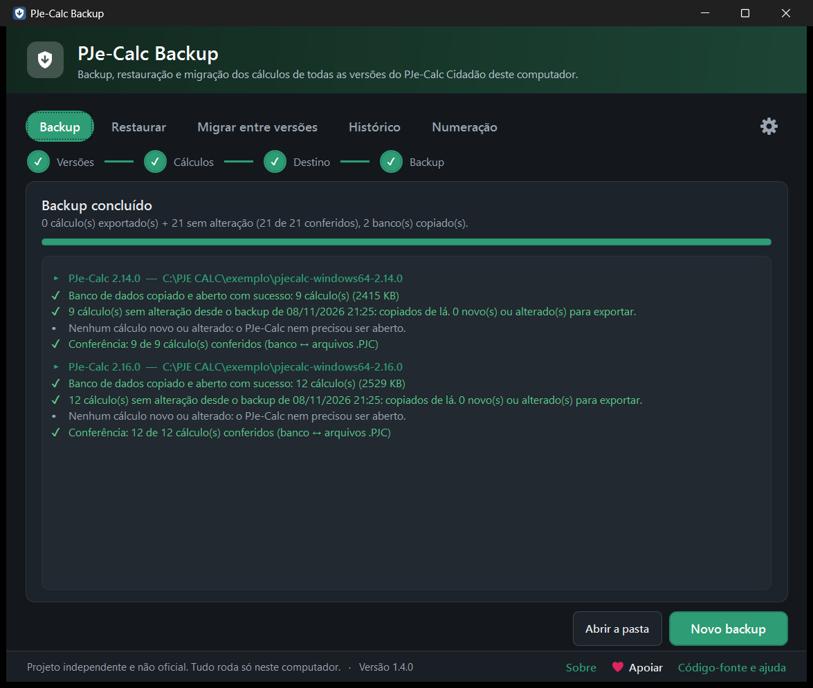<br>
<b>Do seu jeito</b><br>
Tema claro, escuro ou seguindo o Windows, 33 paletas de cores, sons e notificações do Windows, atalhos de teclado e <a href="../../wiki/Planilha-Excel">planilha (Excel)</a> com todos os cálculos.
</td>
<td valign="top">
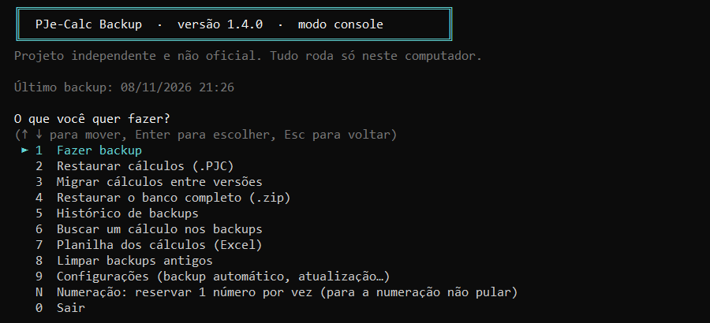<br>
<b>Versão para o CMD</b><br>
As mesmas funções em menus no terminal, e um modo automático para scripts. <a href="#versão-para-o-cmd">Saiba mais</a>.
</td>
</tr>
</table>

## Como usar

1. **[Baixe o `PJeCalcBackup.exe`](../../releases/latest)** e dê dois cliques.
2. Clique em **Instalar** na faixa do topo. É rápido, não pede senha de administrador e cria atalhos na Área de Trabalho e no menu Iniciar. (Também dá para usar sem instalar.)
3. Na aba **Backup**, clique em **Avançar** duas vezes e em **Concluir**. Pronto: o primeiro backup está na pasta `BKP PJC PJECALC`, na Área de Trabalho.
4. Em **⚙ → Backup automático**, escolha os dias e o horário para não precisar lembrar.
5. Se aparecer a faixa **"A numeração dos cálculos… pode pular"**, clique em **Ver e corrigir**.

> Na primeira vez o Windows pode mostrar **"O Windows protegeu o computador"**, porque o programa não tem assinatura digital, que é paga. Clique em **Mais informações → Executar assim mesmo**. Os arquivos são compilados pelo próprio GitHub a partir deste código, e o SHA-256 de cada um aparece na página de [Releases](../../releases/latest).

O passo a passo completo, com uma foto de cada tela, está no **[Wiki](../../wiki)**:

| Começar | Usar | Ajuda |
|---|---|---|
| [Instalação](../../wiki/Instalação) | [Restaurar](../../wiki/Restaurar) | [Configurações](../../wiki/Configurações) |
| [Primeiros passos](../../wiki/Primeiros-passos) | [Migrar entre versões](../../wiki/Migrar-entre-versões) | [Versão para o CMD](../../wiki/Versão-para-o-CMD) |
| [Fazer backup](../../wiki/Fazer-backup) | [Histórico e busca](../../wiki/Histórico-e-busca) | [Perguntas frequentes](../../wiki/Perguntas-frequentes) |
| [Backup automático](../../wiki/Backup-automático) | [Numeração dos cálculos](../../wiki/Numeração-dos-cálculos) | [Como funciona por dentro](../../wiki/Como-funciona) |
| | [Planilha (Excel)](../../wiki/Planilha-Excel) | [Apoie o projeto](../../wiki/Apoie-o-projeto) |

## Seguro por padrão

- **Nunca encerra o PJe-Calc à força.** Se ele estiver aberto, o programa o fecha do mesmo jeito que o **Sair** do ícone perto do relógio e o reabre no final.
- **O banco original não é alterado no backup.** A lista de cálculos é lida de uma cópia temporária.
- **Antes de restaurar, migrar ou mudar a numeração**, guarda uma cópia do banco. Dá para desfazer pelo Histórico.
- **Nada é apagado sem perguntar.** A limpeza de backups antigos mostra a lista antes e manda para a Lixeira. O backup mais recente sem falhas nunca sai.
- **Tudo roda no seu computador.** A internet só é usada para ver se há versão nova no GitHub (dá para desligar) e para baixá-la quando você pede. A atualização confere o SHA-256 de cada arquivo.

## Numeração dos cálculos

A numeração do PJe-Calc às vezes pula, por exemplo do cálculo 2 para o 33. Não é defeito nos cálculos: o banco do PJe-Calc reserva 32 números de cada vez, e quando ele fecha de forma anormal (queda de energia, computador desligado com ele aberto) os números reservados se perdem.

A aba **Numeração** (atalho Ctrl + 5):

- faz o PJe-Calc **reservar 1 número por vez**, para a numeração não pular mais;
- **muda o número dos cálculos**, um por um ou todos em sequência (1, 2, 3…), pela ordem atual, pela data de criação, pelo reclamante ou pelo processo, com filtro para achar um cálculo.

Quando alguma versão ainda reserva 32 números, uma faixa no topo da janela avisa e leva direto à correção. Na versão para o CMD, a opção **N** do menu faz a mesma correção da reserva.

<p align="center">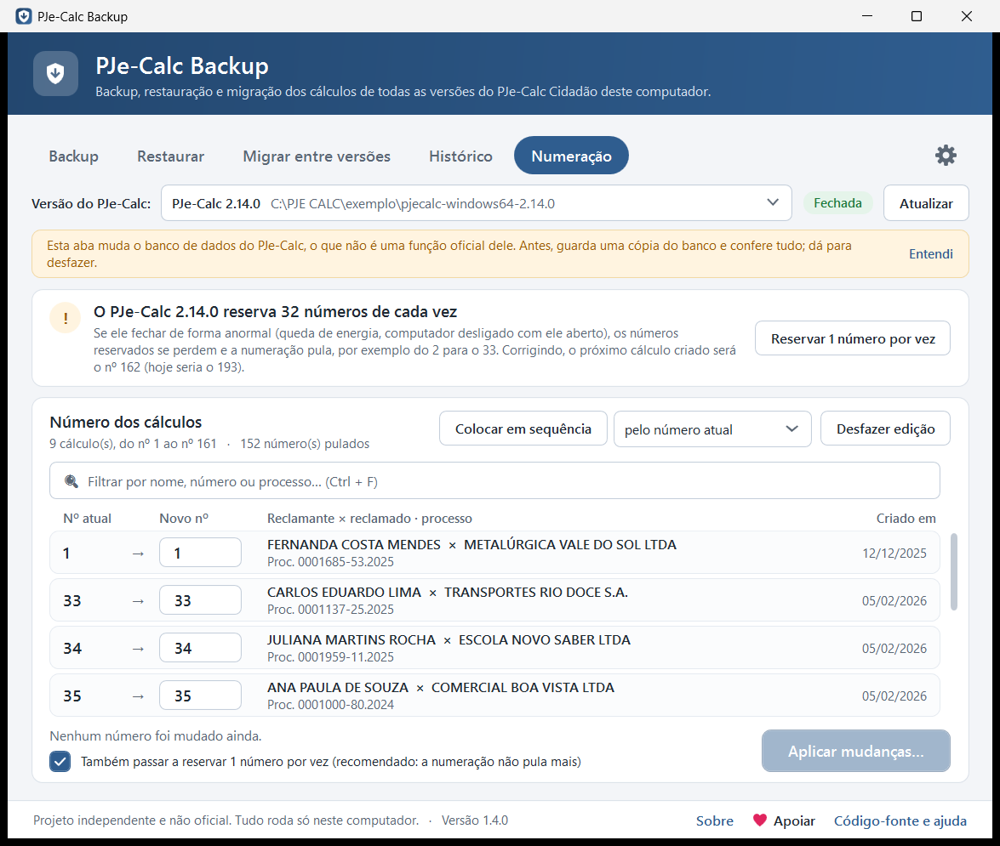</p>

> [!WARNING]
> Esta aba **muda o banco de dados do PJe-Calc**, o que não é uma função oficial do PJe-Calc. Antes de cada mudança, o programa guarda uma cópia do banco na pasta de backups, faz tudo numa cópia e confere (mesmos registros de cada cálculo, nenhum registro solto). Só então troca o banco. Dá para desfazer pela própria aba ou pelo Histórico.

A mudança de número só é liberada nas versões do PJe-Calc em que foi conferido que o código de validação do cálculo não usa o número (hoje 2.13.0, 2.14.0 e 2.16.0). Passo a passo: **[Numeração dos cálculos](../../wiki/Numeração-dos-cálculos)**.

## Versão para o CMD

O programa traz junto o `PJeCalcBackup-Console.exe`, com as mesmas funções em menus no terminal, e um modo automático para scripts:

```
PJeCalcBackup-Console.exe --backup --rapido
```

<p align="center">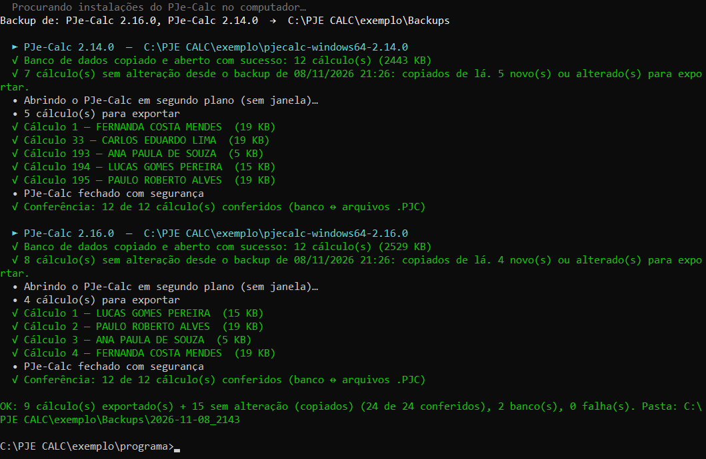</p>

| Escolha das versões | Apoie, com QR Code no terminal |
|---|---|
| 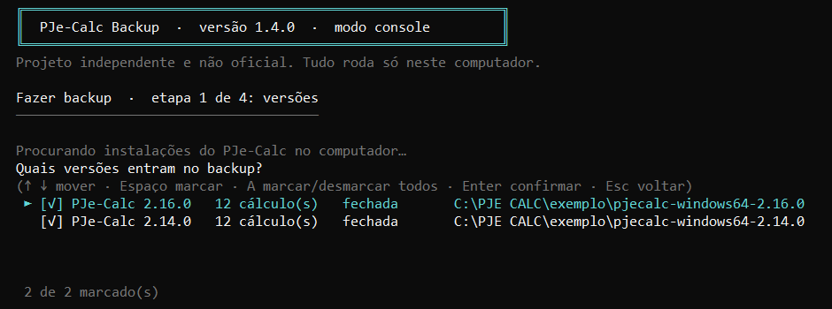 | 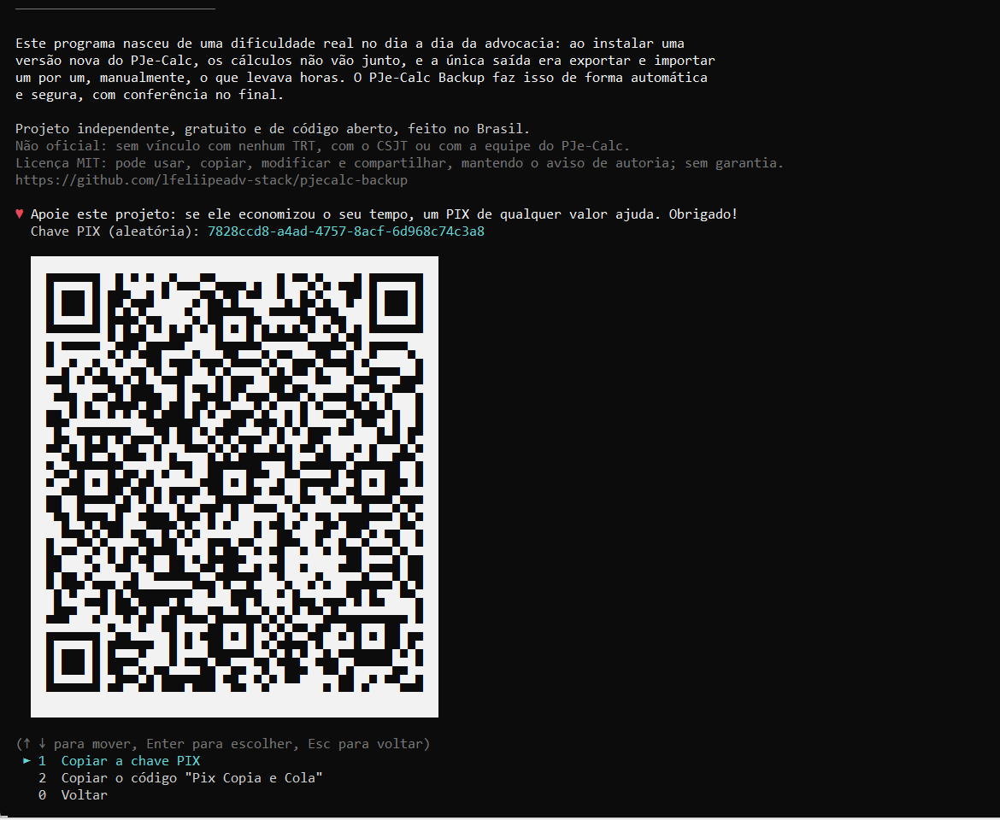 |

Menus, arrastar e soltar e todos os parâmetros: **[Versão para o CMD](../../wiki/Versão-para-o-CMD)**.

## Downloads

| Arquivo | Para quê |
|---|---|
| `PJeCalcBackup.exe` | O programa com janela. Já traz dentro a versão para o CMD. É o recomendado. |
| `PJeCalcBackup-vX.Y.Z.zip` | Os arquivos separados: o programa, a versão para o CMD (`PJeCalcBackup-Console.exe`) e o `backup-calculos.bat`. |
| `SHA256.txt` | Os códigos para conferir que o arquivo baixado é o publicado. |

**Requisitos:** Windows 10 ou 11 (usa o .NET Framework 4.8, que já vem no Windows) e Microsoft Edge ou Google Chrome, usados de forma invisível para exportar e importar os `.PJC`. Testado no PJe-Calc Cidadão **2.14.0** e **2.16.0**.

## Sobre

Este programa nasceu de uma dificuldade real no dia a dia da advocacia: ao instalar uma versão nova do PJe-Calc, os cálculos não vão junto, e a única saída era exportar e importar um por um. O PJe-Calc Backup faz isso de forma automática e segura, com conferência no final.

As fotos desta página e do Wiki foram feitas com **dados fictícios**: nomes, empresas e processos inventados, em duas instalações de teste do PJe-Calc.

## Limitações conhecidas

- O programa segue o caminho das telas do PJe-Calc para exportar e importar. Uma versão futura do PJe-Calc pode mudar algo e exigir ajuste; confira sempre a conferência e o `relatorio.txt`.
- Cada `.PJC` importado vira um cálculo novo, com número novo. É assim que o PJe-Calc funciona; a aba Numeração pode pôr os números em ordem depois.
- A detecção de duplicados compara reclamante, reclamado, processo e as datas do contrato e do cálculo. Dois cálculos iguais nesses dados são tratados como o mesmo.
- Mudar o número dos cálculos só é liberado nas versões do PJe-Calc já conferidas. Numa versão nova, essa parte fica bloqueada até uma atualização do programa; a reserva de 1 número continua disponível.
- Uma versão do PJe-Calc que nunca foi aberta precisa ser aberta uma vez pelo atalho oficial antes do primeiro uso.

## Privacidade

Os arquivos `.PJC`, o banco e a planilha têm dados pessoais das partes (nomes, CPF etc.). Guarde os backups em local seguro e **nunca** os coloque em repositórios públicos nem os anexe a uma *issue*. O [`.gitignore`](.gitignore) deste projeto já bloqueia esses arquivos.

## Código-fonte

| Pasta | O que é |
|---|---|
| [`app/`](app/) | O programa, em C# com WPF. Sem bibliotecas externas. |
| [`backup-calculos/`](backup-calculos/) | O `.bat` que abre a versão para o CMD. |
| [`.github/workflows/`](.github/workflows/) | Compila e publica cada versão a partir de uma tag `v*`. |

Para compilar, basta o compilador que já vem no Windows:

```powershell
powershell -ExecutionPolicy Bypass -File app\compilar.ps1
```

Os executáveis ficam em `app\saida`. Detalhes técnicos em **[Como funciona](../../wiki/Como-funciona)**.

## Contribuindo

Encontrou um problema ou testou em outra versão do PJe-Calc? Abra uma [*issue*](../../issues) dizendo a versão do PJe-Calc, a do PJe-Calc Backup (aparece no rodapé do programa) e a do Windows. Se colar o `relatorio.txt`, **apague os nomes das partes antes**.

## ❤️ Apoie este projeto

O PJe-Calc Backup é gratuito e continuará sendo. Se ele economizou o seu tempo, você pode apoiar o desenvolvimento com um PIX de qualquer valor. Obrigado!

**Chave PIX (aleatória):** `7828ccd8-a4ad-4757-8acf-6d968c74c3a8`


No app do banco: **Pix → Pagar com chave** (cole a chave) ou leia o QR Code. O nome do recebedor aparece antes de você confirmar. A chave e o QR Code também ficam no programa, em **⚙ → Apoie este projeto**.

Também ajuda dar uma ⭐ no repositório e indicar o programa a colegas que usam o PJe-Calc.

## Licença

[MIT](LICENSE): software livre. Pode usar, copiar, modificar e compartilhar, mantendo o aviso de autoria. É fornecido sem garantia.
